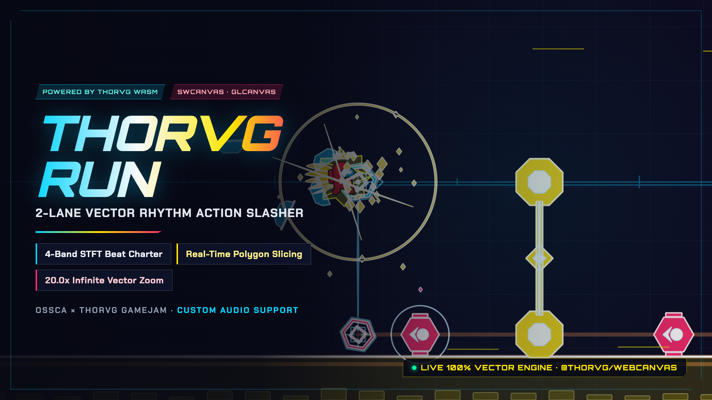
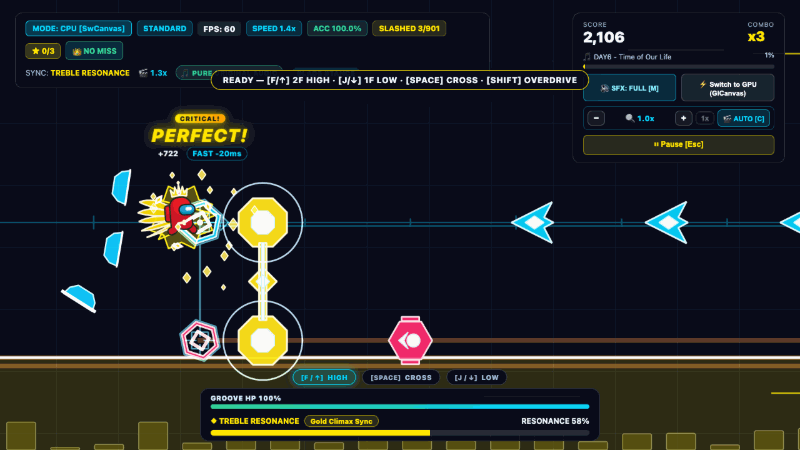
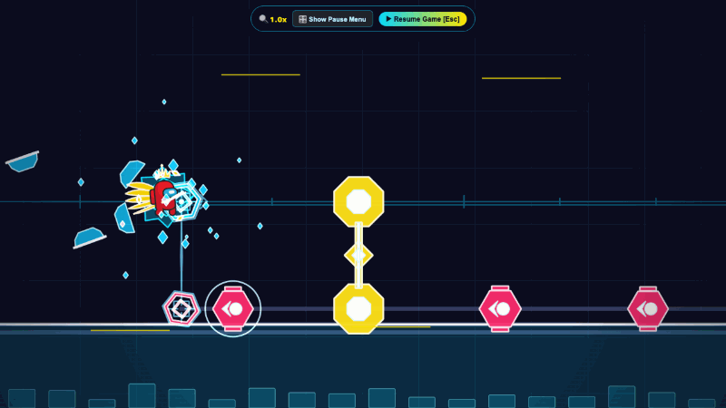
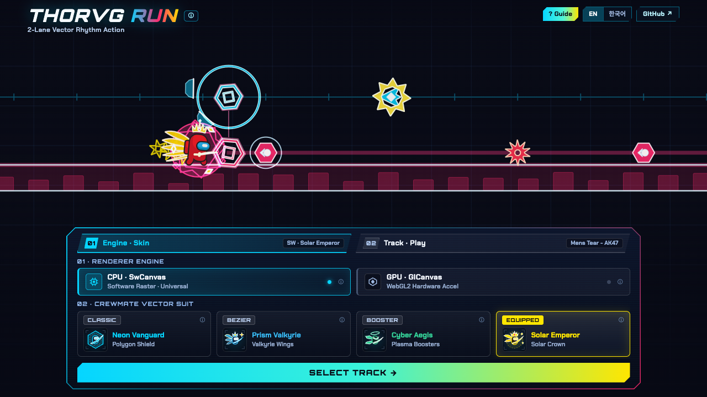
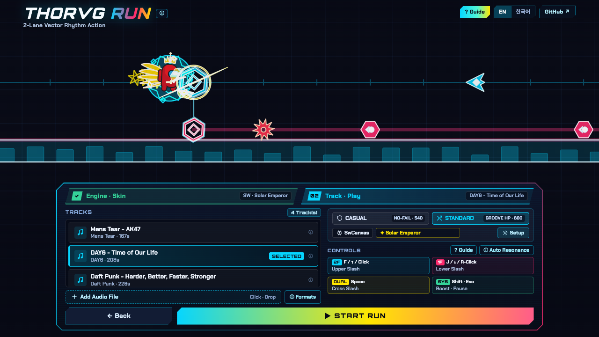
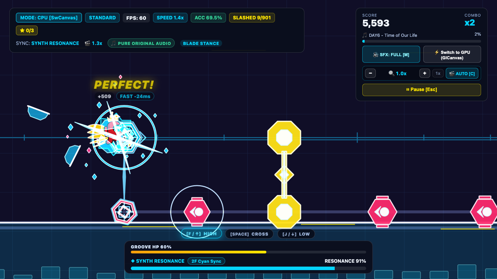
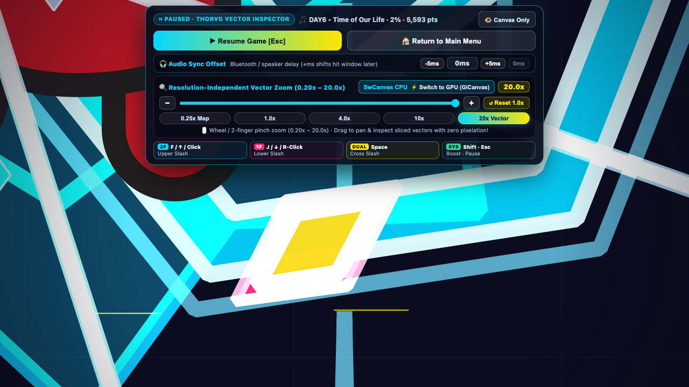

<div align="center">

<a href="https://ossca-thorvg.github.io/GameJam-ThorVG-Run/">
  
</a>

# THORVG RUN

**2-Lane Vector Rhythm Action Slasher Powered by [`@thorvg/webcanvas`](https://www.thorvg.org/) (WASM)**

[](https://ossca-thorvg.github.io/GameJam-ThorVG-Run/)
[](https://www.thorvg.org/)
[](https://react.dev/)
[](https://www.typescriptlang.org/)

[English](#english) · [한국어](#한국어)

</div>

---

## English

### 1. Introduction

**ThorVG Run** is a browser-based **2-lane rhythm action slasher** rendered 100% through **[ThorVG (`@thorvg/webcanvas` v1.1.3)](https://www.thorvg.org/) WASM**.  
Instead of pre-baked sprite sheets or HTML5 2D canvas drawing, every frame—from the Crewmate avatar and layered suit armor to real-time polygon slicing fragments, cubic Bezier katana trails, audio-reactive floor bars, and an inverse-projected horizon grid—is composed natively through ThorVG vectors.

#### Key Highlights
- **Real-Time Client-Side Beat Charter**: Decodes audio in the browser via the Web Audio API (`decodeAudioData`) and runs **STFT spectral flux beat detection** ([`src/audio/TrackAnalyzer.ts`](src/audio/TrackAnalyzer.ts), [`src/audio/dsp/beatDetector.ts`](src/audio/dsp/beatDetector.ts)) across both built-in music and custom user-uploaded audio files.
- **CPU & GPU Runtime Renderer Switching**: Toggle live at any time—on the setup screen, during gameplay, or while paused—between **CPU (`SwCanvas`)** software rasterization and **GPU (`GlCanvas`)** WebGL2 acceleration without reloading the page.
- **2-Lane Slash & Cross-Chord Action**: Slice **2F Upper (Cyan)** and **1F Lower (Crimson)** targets, trigger **Dual Cross (Gold)** simultaneous chords (`≤ 50ms` chord sync window), sustain **Hold** ribbons, burst through **Rush** patterns, and dodge **Sawblade / Mine** hazards while charging **Treble / Bass Resonance** for **Overdrive**.
- **20.0x Infinite Vector Zoom Inspector**: Pause at any moment (`Esc` / `P`) and zoom from **`0.20x` to `20.0x`** (live gameplay supports `0.35x – 4.0x`) with smooth mouse/touch panning to inspect sliced polygons, Bezier strokes, and Lottie character compositing with **zero pixelation**.
- **4 Procedural Vector Suits & Bilingual UI**: Select and equip **Neon Vanguard**, **Prism Valkyrie**, **Cyber Aegis**, and **Solar Emperor**, rendered via procedural ThorVG shapes wrapping a matrix-transformed Lottie rig, with full **English / 한국어** localization.

---

### 2. Screenshots & Gameplay GIFs

#### Gameplay & Infinite Vector Zoom

<table>
  <tr>
    <th width="50%">Live 2-Lane Rhythm Slashing & Real-Time Slicing</th>
    <th width="50%">Paused <code>1.0x → 20.0x</code> Infinite Vector Zoom Inspector</th>
  </tr>
  <tr>
    <td align="center">
      
    </td>
    <td align="center">
      
    </td>
  </tr>
</table>

#### Feature Gallery

<table>
  <tr>
    <td width="50%" align="center">
      
      <br /><sub><b>Step 1 · Engine & Suit Setup</b> — Live interactive ThorVG backdrop with CPU (<code>SwCanvas</code>) / GPU (<code>GlCanvas</code>) selector & 4 Crewmate Vector Suits.</sub>
    </td>
    <td width="50%" align="center">
      
      <br /><sub><b>Step 2 · Track & Mode Setup</b> — Choose from 4 built-in tracks or upload custom audio alongside Casual / Standard difficulty & input guide.</sub>
    </td>
  </tr>
  <tr>
    <td width="50%" align="center">
      
      <br /><sub><b>In-Game HUD & Real-Time Slicing</b> — Beat-reactive Groove HP, Treble/Synth Resonance overdrive gauge, timing delta (<code>FAST -24ms</code>), and bisected vector halves.</sub>
    </td>
    <td width="50%" align="center">
      
      <br /><sub><b>20.0x Pause Vector Inspector</b> — Crystal-clear vector geometry at 2000% magnification plus <code>±5ms</code> Bluetooth/speaker Audio Sync Offset calibration.</sub>
    </td>
  </tr>
</table>

---

### 3. Controls

All desktop bindings are handled by [`InputController.ts`](src/engine/InputController.ts) and [`GameEngine.ts`](src/engine/GameEngine.ts).

#### Gameplay & Action

| Action | Keyboard | Mouse | Touch (Mobile) |
| :--- | :--- | :--- | :--- |
| **2F Upper Lane Slash (Cyan)** | `F` / `D` / `W` / `↑` | **Left Click** | Tap **Upper Half** of screen |
| **1F Lower Lane Slash (Crimson)** | `J` / `K` / `S` / `↓` | **Right Click** | Tap **Lower Half** of screen |
| **Gold Dual Cross Slash (Chord)** | `Space` (or press High + Low simultaneously `≤ 50ms`) | **Middle Click** | Simultaneous upper + lower tap |
| **Overdrive Burst** | `Shift` / `E` | — | Tap HUD button when full |
| **Pause / Vector Inspector** | `Esc` / `P` | Pause Button (`II`) | HUD Pause Button |

#### Camera, Audio & Pause Inspector

| Action | Shortcut | Notes |
| :--- | :--- | :--- |
| **Zoom In / Out** | `=` (`+`) / `-` / Mouse Wheel / 2-Finger Pinch | Live: `0.35x – 4.0x` (`1.2x` step) · Paused: `0.20x – 20.0x` |
| **Reset Zoom (`1.0x`)** | `0` | Also resets pause view via `Reset 1.0x` button |
| **Pan Canvas (Paused)** | Drag Left Mouse / Drag Touch | Inspect bisected polygons & character vectors freely |
| **Zoom Presets (Paused)** | UI Buttons (`0.25x`, `1.0x`, `4.0x`, `10x`, `20x`) | Jump directly to macro map view or `20.0x` close-up |
| **Toggle Canvas-Only Mode** | `Canvas Only` / `Show Pause Menu` button | Hides HUD/overlay panels during paused zoom inspection |
| **Toggle Cinematic Auto-Cam** | `C` | Dynamic zoom/tilt motion synchronized with play intensity |
| **Cycle SFX Mode** | `M` | Cycles `Full` → `Impact Only` → `Off` |
| **Audio Sync Offset** | `-5ms` / `+5ms` / Reset (`0ms`) in Pause Menu | Compensates speaker / Bluetooth delay alongside Web Audio latency |
| **Return to Main Menu (Paused)** | `Q` | Exits current run safely back to setup screen |

#### Difficulty Modes & Timing Windows

| Mode | Scroll Speed | `PERFECT` Window | Notes |
| :--- | :---: | :---: | :--- |
| **Casual** | `540 px/s` | `±72ms` (`GREAT ±130ms`, `GOOD ±180ms`) | Accessible pacing and fewer hazards |
| **Standard** | `680 px/s` | `±52ms` | Tighter timing, denser beatmap & twin/rush patterns |

---

### 4. ThorVG Features Used

Every visual layer is engineered inside [`src/renderer/`](src/renderer/ThorVGRenderer.ts) using **`@thorvg/webcanvas` v1.1.3**:

1. **Dual-Backend WASM Canvas & Serialized Lifecycle ([`ThorVGRenderer.ts`](src/renderer/ThorVGRenderer.ts))**
   - Initializes ThorVG via `ThorVG.init({ renderer })` with runtime switching between **`SwCanvas` (CPU Software Rasterizer)** and **`GlCanvas` (WebGL2 Hardware Accelerator)** on a HiDPI canvas (`new TVG.Canvas(canvas, { enableDevicePixelRatio: true })`).
   - Protects WASM memory across live switches and resets through a serialized promise queue (`enqueueEngineJob`), explicit object `.dispose()`, `canvas.destroy()`, and `TVG.term()`.

2. **Zero-Allocation Persistent 30-Layer `TVG.Shape` Pool ([`shapePool.ts`](src/renderer/passes/shapePool.ts))**
   - Instead of instantiating thousands of short-lived path objects each frame, ThorVG Run allocates a fixed pool of **30 persistent `TVG.Shape` layers** ordered by strict Painter's Algorithm depth (`bg`, `aurora`, `grid`, ..., `waveGlow`, ..., `playerGlow`, `playerCore`, `skinFront`, `skinFrontGlow`, `vfxSlicedCyan`, `vfxSlashCore`).
   - Each layer reuses `.reset()`, `.moveTo()`, `.lineTo()`, `.cubicTo()`, `.close()`, `.appendRect()`, `.fill()`, and `.stroke()` every animation frame for smooth 60 FPS performance.

3. **`TVG.BlendMethod.Add` Bloom & `EvenOdd` / `NonZero` Winding Polygons ([`macroWorldPass.ts`](src/renderer/passes/macroWorldPass.ts), [`playerGeometry.ts`](src/renderer/passes/playerGeometry.ts))**
   - **16 energy, halo, trail, and slash layers** use `TVG.BlendMethod.Add` directly inside ThorVG to create crisp additive neon glows without CSS blur filters.
   - `TVG.FillRule.EvenOdd` carves concentric expanding shockwave rings (`appendCircle` outer + inner loops) across `vfxGold`, `vfxCyan`, and `vfxCrimson`, while opposite clockwise/counter-clockwise `NonZero` winding builds hollow rings (`appendHollowPolygonRing` on `bandBass`/`bandSynth`/`bandTreble`), rotating hollow prism stars (`appendHollowPrismStarHalo` on `prismStars`), and serrated hazard gears with central bores (`appendSerratedSawblade` on `traps`).
   - **Real-Time Polygon Bisecting**: Hit targets split into upper and lower **bisected half polygons** (`vfxSlicedCyan`, `vfxSlicedCrimson`, `vfxSlicedGold`), accompanied by glowing fracture seam quads (`appendCutSeamQuad`) and **3rd-order Cubic Bezier tapered katana trails** (`appendTaperedBlade`).

4. **Hybrid `TVG.Animation` Lottie Compositing & 3×3 Affine Matrix ([`characterMatrix.ts`](src/renderer/characterMatrix.ts), [`splashLottie.ts`](src/renderer/splashLottie.ts))**
   - **Character Matrix Sandboxing**: Loads the Crewmate Lottie animation (`TVG.Animation`) and positions/rotates/scales it cleanly every frame via `buildCharacterMatrix` (3×3 affine `Matrix` `e11..e33` + `Picture.size()`), sandwiched between procedural ThorVG `playerGlow`/`playerCore` (back aura, combo halo, wings/thrusters/mantle) and `skinFront`/`skinFrontGlow` (katana, shield emblem, crystal tiara, cyber halo/V-visor crest, imperial crown/orbiting solar shards) layers.
   - **Runtime Matte Precomp Expansion**: `prepareSplashLottie` inspects the *Powered by ThorVG* Lottie JSON before passing it to `TVG.Animation`, expanding precomp/root bounds (`PAD_X = 640`, `PAD_Y = 820` → `3200×2720`, viewport fit `0.54`) so Lottie track mattes never clip near viewport edges.

5. **Resolution-Independent `0.20x – 20.0x` Infinite Vector Zoom & Inverse Projection**
   - Camera transforms scale every world shape uniformly in ThorVG vector space while computing inverse screen-to-world bounds (`invTx`, `invTy`) for the infinite horizon grid and waveform floor—delivering crisp sub-pixel edges even at **`20.0x` paused zoom**.

---

### 5. Built-In Tracks, Custom Audio & Local Development

#### Built-In Tracks ([`proceduralTracks.ts`](src/audio/proceduralTracks.ts)) & Custom Uploads ([`audioFormats.ts`](src/audio/audioFormats.ts))
- **4 Included Tracks** (under `src/asset/music/`):
  - `Mens Tear - AK47`
  - `DAY6 - Time of Our Life`
  - `Daft Punk - Harder, Better, Faster, Stronger`
  - `유정석 - 질풍가도` *(Yoo Jeong-seok — Jilpunggado)*
- **Custom Audio Upload**: Drag-and-drop or browse local music (`MP3`, `MP4`, `WAV`, `AAC / M4A`, `FLAC`, `OGG`, `OPUS`, `WEBM` · max `50 MB` · minimum duration `5s`)—analyzed automatically on the client into playable 2-lane charts.

#### Run Locally

```bash
# 1. Install dependencies (includes vendored @thorvg/webcanvas)
npm install

# 2. Start Vite dev server
npm run dev

# 3. Type-check and build production bundle (outputs to dist/)
npm run build

# 4. Preview production build locally
npm run preview
```

---

### 6. Team & Roles

| Contributor | Role | Scope |
| :--- | :--- | :--- |
| **[J-unStiN](https://github.com/J-unStiN)** | **Solo Developer** *(1인 개발)* | Game Design · 2-Lane Rhythm Engine & Strict Chord Judgment · 4-Band STFT Beat Charter · Dual CPU/GL ThorVG WASM Vector Renderer · Procedural Suit & Polygon Slicing VFX · React/TS UI & Bilingual (EN/KO) i18n |

---

### 7. Credits

- **Vector Graphics Engine**: [ThorVG](https://www.thorvg.org/) (`@thorvg/webcanvas` v1.1.3 WebAssembly, `thorvg.wasm`) — OSSCA × ThorVG GameJam
- **Character & Branding Lottie Animations**:
  - Crewmate Lottie Rig (`src/asset/Loading 50 _ Among Us.json`)
  - Powered by ThorVG Splash Animation ([`powred.by.thorvg.1.json`](src/logo/powred.by.thorvg.1.json))
- **Built-In Music Assets (`src/asset/music/`)**:
  - *Mens Tear — AK47*
  - *DAY6 — Time of Our Life (한 페이지가 될 수 있게)*
  - *Daft Punk — Harder, Better, Faster, Stronger*
  - *유정석 — 질풍가도 (쾌걸 근육맨 2세 1기 여는노래)*
- **Core Stack & Typography**: React `18.3`, TypeScript `5.7`, Vite `6.0`, Web Audio API, Google Fonts (`Orbitron` & `Chakra Petch`)

---

<br />

## 한국어

[▲ English](#english)

### 1. 소개

**ThorVG Run**은 **[ThorVG (`@thorvg/webcanvas` v1.1.3)](https://www.thorvg.org/) WASM** 벡터 엔진만으로 매 프레임을 그려내는 **2레인 리듬 액션 슬래셔 게임**입니다.  
미리 구워진 스프라이트나 일반 HTML5 2D 캔버스 API를 쓰지 않고, 캐릭터 슈트와 Lottie 리깅부터 실시간 폴리곤 절단 파편, 3차 베지어 카타나 궤적, 비트 반응형 이퀄라이저 플로어, 무한 역투영 그리드까지 모든 시각 요소를 순수 ThorVG 벡터로 렌더링합니다.

#### 핵심 특징
- **실시간 브라우저 STFT 비트 분석 차터**: Web Audio API(`decodeAudioData`)와 4밴드 **STFT 스펙트럼 플럭스(Spectral Flux)** 분석([`TrackAnalyzer.ts`](src/audio/TrackAnalyzer.ts), [`beatDetector.ts`](src/audio/dsp/beatDetector.ts))으로 기본 수록곡은 물론 사용자가 업로드한 음악도 즉시 2레인 채보로 변환합니다.
- **CPU / GPU 렌더러 실시간 전환**: 타이틀 화면, 인게임 플레이 중, 일시정지 상태 어느 시점에서나 새로고침 없이 **CPU(`SwCanvas`)** 소프트웨어 래스터라이저와 **GPU(`GlCanvas` WebGL2)** 가속 백엔드를 즉시 전환할 수 있습니다.
- **2레인 베기 & 듀얼 크로스(Chord) 액션**: **2F 상단(시안)** 및 **1F 하단(크림슨)** 노트 타격, 동시 입력을 엄격하게 판정(`≤ 50ms` 동기화 윈도우)하는 **골드 듀얼 크로스**, 롱 홀드(Hold), 러시(Rush), 회전 톱날/지뢰(Hazard) 회피와 **트레블/베이스 공명(Resonance)** 기반 **오버드라이브(Overdrive)** 시스템을 지원합니다.
- **최대 `20.0x` 무한 벡터 줌 인스펙터**: 플레이 중 언제든 일시정지(`Esc` / `P`) 후 **`0.20x ~ 20.0x`**(실시간 플레이 중 `0.35x ~ 4.0x`)까지 자유롭게 확대·이동(드래그/핀치)하여 절단된 도형 단면과 베지어 곡선이 **계단 현상(픽셀 깨짐) 없이** 선명하게 유지되는 것을 직접 확인할 수 있습니다.
- **4종의 프로시저럴 벡터 슈트 & 한/영 완벽 지원**: **Neon Vanguard**, **Prism Valkyrie**, **Cyber Aegis**, **Solar Emperor** 슈트를 제공하며 한국어/영어 UI 전환을 지원합니다.

---

### 2. 스크린샷 & 플레이 GIF

#### 실시간 액션 & 20.0x 무한 벡터 줌 시연

<table>
  <tr>
    <th width="50%">실시간 2레인 리듬 슬래시 & 폴리곤 절단 액션</th>
    <th width="50%">일시정지 <code>1.0x → 20.0x</code> 무한 벡터 줌 인스펙터</th>
  </tr>
  <tr>
    <td align="center">
      
    </td>
    <td align="center">
      
    </td>
  </tr>
</table>

#### 주요 화면 갤러리

<table>
  <tr>
    <td width="50%" align="center">
      
      <br /><sub><b>1단계 · 엔진 & 슈트 선택</b> — 살아 움직이는 ThorVG 벡터 무대 위에서 <code>SwCanvas</code>(CPU) / <code>GlCanvas</code>(GPU) 전환 및 4종 슈트 장착</sub>
    </td>
    <td width="50%" align="center">
      
      <br /><sub><b>2단계 · 트랙 & 난이도 선택</b> — 4개의 기본 수록곡 또는 로컬 오디오 업로드, Casual/Standard 난이도 및 조작 안내</sub>
    </td>
  </tr>
  <tr>
    <td width="50%" align="center">
      
      <br /><sub><b>실전 플레이 & 실시간 절단 VFX</b> — Groove HP, 공명(Resonance) 게이지, 정밀 판정(<code>FAST -24ms</code>) 및 양단된 폴리곤 파편</sub>
    </td>
    <td width="50%" align="center">
      
      <br /><sub><b>20.0x 벡터 인스펙터 & 싱크 보정</b> — 20배 확대에서도 선명한 벡터 경계선 확인 및 <code>±5ms</code> 오디오 싱크 오프셋 조절</sub>
    </td>
  </tr>
</table>

---

### 3. 조작법

모든 데스크톱 입력은 [`InputController.ts`](src/engine/InputController.ts) 및 [`GameEngine.ts`](src/engine/GameEngine.ts)에 구현되어 있습니다.

#### 게임플레이 & 슬래시

| 동작 | 키보드 | 마우스 | 모바일 터치 |
| :--- | :--- | :--- | :--- |
| **2F 상단 레인 베기 (시안)** | `F` / `D` / `W` / `↑` | **좌클릭** | 화면 **상단 절반** 터치 |
| **1F 하단 레인 베기 (크림슨)** | `J` / `K` / `S` / `↓` | **우클릭** | 화면 **하단 절반** 터치 |
| **골드 듀얼 크로스 (동시 베기)** | `Space` (또는 상·하단 키 `≤ 50ms` 이내 동시 입력) | **가운데 버튼 클릭** | 상단 + 하단 동시 터치 |
| **오버드라이브 발동** | `Shift` / `E` | — | 게이지 충전 시 HUD 버튼 탭 |
| **일시정지 (벡터 인스펙터)** | `Esc` / `P` | HUD 일시정지 버튼 (`II`) | HUD 일시정지 버튼 |

#### 카메라 줌, 오디오 및 일시정지 도구

| 동작 | 단축키 / 조작 | 설명 |
| :--- | :--- | :--- |
| **벡터 줌 확대 / 축소** | `=` (`+`) / `-` / 마우스 휠 / 두 손가락 핀치 | 플레이 중 `0.35x ~ 4.0x` (`1.2x` 배율) · 일시정지 시 `0.20x ~ 20.0x` |
| **줌 초기화 (`1.0x`)** | `0` | 일시정지 화면의 `Reset 1.0x` 버튼으로도 초기화 가능 |
| **화면 이동 (패닝)** | 일시정지 상태에서 마우스/터치 드래그 | 절단된 벡터 파편과 캐릭터 세부 레이어를 자유롭게 이동하며 관찰 |
| **줌 프리셋 (일시정지)** | `0.25x`, `1.0x`, `4.0x`, `10x`, `20x` 버튼 | 전체 맵 조감도부터 20배 초근접 벡터 검사 뷰까지 원클릭 이동 |
| **캔버스만 보기 (UI 숨김)** | `Canvas Only` / `Show Pause Menu` 버튼 | 일시정지 오버레이를 접고 순수 ThorVG 캔버스만 전체 감상 |
| **시네마틱 카메라 전환** | `C` | 리듬·오버드라이브 강도에 연동되는 다이나믹 카메라 ON/OFF |
| **효과음(SFX) 모드 전환** | `M` | `Full` → `Impact Only` → `Off` 순환 |
| **오디오 싱크 오프셋 보정** | 일시정지 메뉴 `-5ms` / `+5ms` / 초기화(`0ms`) | 블루투스/스피커 지연 오차 미세 보정 |
| **메인 메뉴로 복귀 (일시정지)** | `Q` | 현재 런을 안전하게 종료하고 메뉴로 복귀 |

#### 난이도별 스크롤 속도 및 판정 범위

| 난이도 | 스크롤 속도 | `PERFECT` 판정 범위 | 특징 |
| :--- | :---: | :---: | :--- |
| **Casual** | `540 px/s` | `±72ms` (`GREAT ±130ms`, `GOOD ±180ms`) | 입문 친화적 템포 및 장애물 완화 |
| **Standard** | `680 px/s` | `±52ms` | 정밀 판정, 고밀도 동시타(Cross) 및 러시 패턴 |

---

### 4. 사용한 ThorVG 기능

모든 렌더링 파이프라인은 [`src/renderer/`](src/renderer/ThorVGRenderer.ts) 내에서 **`@thorvg/webcanvas` v1.1.3** API를 직접 제어해 구현했습니다.

1. **이중 백엔드 WASM 캔버스 & 직렬화 수명주기 ([`ThorVGRenderer.ts`](src/renderer/ThorVGRenderer.ts))**
   - `ThorVG.init({ renderer })`와 `new TVG.Canvas(canvas, { enableDevicePixelRatio: true })`를 사용해 **CPU(`SwCanvas`)**와 **GPU(`GlCanvas` WebGL2)** 백엔드를 런타임에서 즉각 교체합니다.
   - 백엔드 전환이나 게임 재시작 시 비동기 작업 큐(`enqueueEngineJob`)로 렌더링 순서를 보장하고 `.dispose()`, `canvas.destroy()`, `TVG.term()`을 순차 호출해 WASM 힙 누수를 방지합니다.

2. **할당 제로(Zero-Allocation) 30레이어 `TVG.Shape` 풀 ([`shapePool.ts`](src/renderer/passes/shapePool.ts))**
   - 매 프레임 수천 개의 객체를 새로 생성해 GC 스파이크를 유발하는 대신, Painter's Algorithm 깊이 순서대로 **30개의 영구 `TVG.Shape` 레이어 풀**(`bg`, `aurora`, `grid`, ..., `waveGlow`, ..., `playerGlow`, `playerCore`, `skinFront`, `skinFrontGlow`, `vfxSlicedCyan`, `vfxSlashCore`)을 미리 할당합니다.
   - 각 프레임에서는 `.reset()`, `.moveTo()`, `.lineTo()`, `.cubicTo()`, `.close()`, `.appendRect()`, `.fill()`, `.stroke()`로 경로만 갱신해 60 FPS 안정성을 유지합니다.

3. **가산 합성(`TVG.BlendMethod.Add`) & 채움 규칙(`EvenOdd` / `NonZero`) ([`macroWorldPass.ts`](src/renderer/passes/macroWorldPass.ts), [`playerGeometry.ts`](src/renderer/passes/playerGeometry.ts))**
   - 16개의 에너지·후광·레이저·궤적 레이어에 `TVG.BlendMethod.Add`를 적용해 CSS 블러 필터 없이도 ThorVG 엔진 자체만으로 강렬한 네온 발광 효과를 구현했습니다.
   - `TVG.FillRule.EvenOdd`는 `vfxGold`/`vfxCyan`/`vfxCrimson` 레이어의 동심 확장 충격파 링(`appendCircle` 외/내부 루프)을 조각하며, 반시계/시계 반대 방향의 `NonZero` 와인딩 규칙으로는 중공 다각형 링(`bandBass`/`bandSynth`/`bandTreble`의 `appendHollowPolygonRing`), 회전하는 프리즘 스타 헤일로(`prismStars`의 `appendHollowPrismStarHalo`), 중앙 축 구멍이 뚫린 톱니바퀴 장애물(`traps`의 `appendSerratedSawblade`)을 정밀하게 구성했습니다.
   - 타격 시 도형을 상·하단 **2개의 독립 폴리곤 파편**(`vfxSlicedCyan`, `vfxSlicedCrimson`, `vfxSlicedGold`)으로 실제 분할하고, 백열 절단면(`appendCutSeamQuad`)과 **3차 베지어 테이퍼드 카타나 블레이드**(`appendTaperedBlade`)를 그립니다.

4. **`TVG.Animation` Lottie × 3×3 아핀 행렬 합성 및 스플래시 매트 확장 ([`characterMatrix.ts`](src/renderer/characterMatrix.ts), [`splashLottie.ts`](src/renderer/splashLottie.ts))**
   - **하이브리드 캐릭터 샌드위치 렌더링**: Crewmate Lottie(`TVG.Animation`)에 매 프레임 3×3 아핀 변환 행렬(`buildCharacterMatrix`: `e11..e33` + `Picture.size()`)을 적용하고, 그 뒤(`playerGlow`/`playerCore`: 후광·콤보 헤일로·날개/부스터/망토)와 앞(`skinFront`/`skinFrontGlow`: 카타나·실드 엠블럼·크리스탈 티아라·사이버 헤일로/V-바이저·황제 왕관/공전 태양 파편)에 프로시저럴 `TVG.Shape` 레이어를 샌드위치 구조로 겹쳐 그립니다.
   - **Lottie 매트 클리핑 방지**: `prepareSplashLottie`가 *Powered by ThorVG* Lottie JSON의 프리컴프/루트 경계(`PAD_X = 640`, `PAD_Y = 820` → `3200×2720`, 뷰포트 비율 `0.54`)를 런타임에 동적 확장해 트랙 매트 잘림 현상을 원천 방지합니다.

5. **`0.20x ~ 20.0x` 해상도 독립 무한 벡터 줌 & 역투영 월드 그리드**
   - 월드 좌표를 ThorVG 벡터 공간에서 직접 확대/축소하면서 배경 그리드와 플로어는 역투영(`invTx`, `invTy`)으로 재계산해 **`20.0x` 확대 검사 상태에서도 픽셀 뭉개짐 없는 순수 벡터 품질**을 보장합니다.

---

### 5. 기본 수록 곡 & 로컬 실행

#### 기본 수록 곡 ([`proceduralTracks.ts`](src/audio/proceduralTracks.ts)) & 커스텀 오디오 ([`audioFormats.ts`](src/audio/audioFormats.ts))
- **기본 내장 트랙 4종** (`src/asset/music/`):
  - `Mens Tear - AK47` (맨스티어 - AK47)
  - `DAY6 - Time of Our Life` (한 페이지가 될 수 있게)
  - `Daft Punk - Harder, Better, Faster, Stronger`
  - `유정석 - 질풍가도` (쾌걸 근육맨 2세 1기 여는노래)
- **커스텀 오디오 업로드**: `MP3`, `MP4`, `WAV`, `AAC/M4A`, `FLAC`, `OGG`, `OPUS`, `WEBM` 형식 지원 (최대 `50 MB`, 최소 길이 `5초`), 업로드 즉시 클라이언트에서 비트를 분석해 플레이 가능한 채보 생성.

#### 로컬 환경 실행 방법

```bash
# 1. 의존성 설치 (내장 @thorvg/webcanvas 포함)
npm install

# 2. 개발 서버 실행
npm run dev

# 3. 타입 검사 및 프로덕션 빌드 (dist/ 출력)
npm run build

# 4. 빌드 결과물 로컬 미리보기
npm run preview
```

---

### 6. 팀원 역할

| 개발자 | 역할 | 담당 영역 |
| :--- | :--- | :--- |
| **[J-unStiN](https://github.com/J-unStiN)** | **1인 개발 (Solo Developer)** | 게임 기획 및 2레인 리듬/크로스 판정 엔진 · STFT 4밴드 오디오 비트 차터 · CPU/GL ThorVG WASM 벡터 렌더러 · 프로시저럴 슈트 및 실시간 폴리곤 슬라이싱 VFX · React/TS UI & 다국어(KR/EN) 시스템 전담 |

---

### 7. Credits

- **벡터 그래픽스 엔진**: [ThorVG](https://www.thorvg.org/) (`@thorvg/webcanvas` v1.1.3 WebAssembly, `thorvg.wasm`) — OSSCA × ThorVG GameJam
- **캐릭터 및 브랜드 Lottie 리소스**:
  - Among Us Crewmate Lottie (`src/asset/Loading 50 _ Among Us.json`)
  - Powered by ThorVG Splash Lottie ([`powred.by.thorvg.1.json`](src/logo/powred.by.thorvg.1.json))
- **기본 수록 음원 (`src/asset/music/`)**:
  - *맨스티어 — AK47*
  - *DAY6 — 한 페이지가 될 수 있게 (Time of Our Life)*
  - *Daft Punk — Harder, Better, Faster, Stronger*
  - *유정석 — 질풍가도 (쾌걸 근육맨 2세 1기 여는노래)*
- **프론트엔드 스택 및 타이포그래피**: React `18.3`, TypeScript `5.7`, Vite `6.0`, Web Audio API, Google Fonts (`Orbitron` · `Chakra Petch`)
